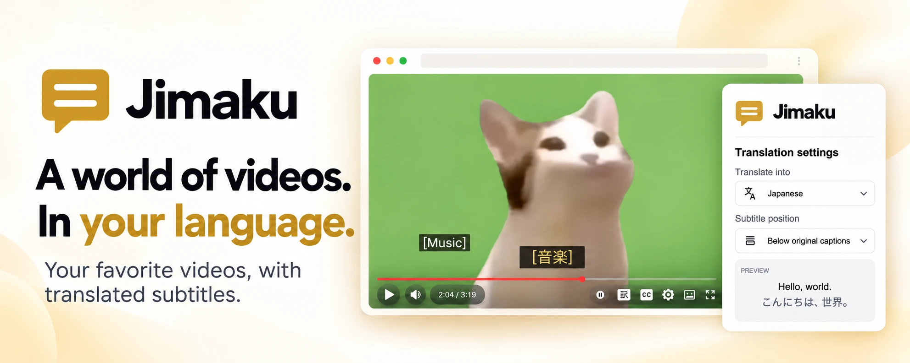

<p align="center"></p>

<h1 align="center">Jimaku</h1>

A Chrome extension that translates YouTube captions and displays them on the video. Turn on YouTube's captions with the CC button to see the original text, with Jimaku's translation below or above it. Caption translation is its only feature.

Translation uses your ChatGPT plan through OpenAI's Sign in with ChatGPT (for open-source and locally hosted apps). Claude API support is planned but not yet available.

> **Use at your own risk.** Sign in with ChatGPT for open-source apps is still a preview, and I'm not sure whether tools like Jimaku are an intended use case. If you sign in with it, you do so at your own risk.

## Features

- A single line of translation below or above YouTube's captions; with CC off, only the translation is shown
- 14 target languages, with Japanese as the default
- Translation starts at the current playback position and streams in line by line
- Translations are cached in the tab, so toggling Jimaku or returning to a video reuses existing translations
- No API key and no API charges: requests count toward the usage included in your ChatGPT plan
- Sign-in credentials are kept in memory, with the option to save them securely using Windows Hello / Touch ID
- The interface supports the same 14 languages and follows your browser's language setting, falling back to English for other languages

## Install

From a release: download `jimaku-vX.Y.Z.zip` from the [Releases](https://github.com/yossyl3oy/jimaku/releases) page and unzip it. Open `chrome://extensions`, turn on Developer mode, click "Load unpacked" and pick the unzipped folder.

From source: you need Chrome, and [mise](https://mise.jdx.dev/) with pnpm (mise installs the Node version in `mise.toml`; the pnpm version is specified in the `packageManager` field in `package.json`).

```bash
mise exec -- pnpm install
mise exec -- pnpm build:release
```

Open `chrome://extensions`, turn on Developer mode, click "Load unpacked" and pick `dist/`.

To update, put the new version's files in the same folder (unzip over it, or build `dist/` again) and click the reload button on Jimaku in `chrome://extensions`. Don't remove the extension to update it: removing it deletes your saved sign-in, and signing in again adds another "Jimaku" to the app usage settings in ChatGPT.

## Use

1. Click the Jimaku icon in the toolbar, click Continue with ChatGPT and sign in. You can then securely save your sign-in credentials using Windows Hello / Touch ID, then use it to unlock Jimaku after a browser restart without signing in again.
2. Open a YouTube video that has captions and click the 訳 button in the player's control bar, just left of the CC button. Jimaku is off until you turn it on, so nothing counts toward your plan's usage until then. The translation of each caption line appears at the bottom of the video.
3. Click the 訳 button again to turn Jimaku off. The setting is remembered and shared across tabs. It works independently of CC: turn CC on to see the original captions.

In the popup (shown here in English; it follows the browser's language):

- **Translate into** — the language to translate into. Changing it restarts translation for open videos in the new language. The button's character follows it: 訳 for Japanese, 역 for Korean, 中 for Chinese, П for Russian and the language code (EN, ES, …) for the others.
- **Subtitle position** — Below original captions (the default) or Above original captions. Changes take effect immediately, and the preview shows the selected order.
- **Manage usage** — opens your ChatGPT usage settings. Jimaku doesn't display usage statistics, because Sign in with ChatGPT offers no way to read them.

When translation can't continue (for example: not signed in, locked after a browser restart, usage limit reached, or the extension was updated while the tab was open), it stops and says why at the top of the video. Translation resumes automatically after you sign in or unlock; after an update, reload the tab.

## Going forward

I plan to keep improving security and prompt efficiency: protecting tokens and saved sign-in credentials, and maintaining translation quality while using fewer tokens.

## Special thanks

Jimaku came together quickly thanks to [Shizue](https://github.com/rokrokss/shizue) by rokrokss. Thank you! I only needed its caption features, so I used its MIT-licensed code to build a small, standalone extension focused on those features. See `NOTICE` for which code came from Shizue.

## License

MIT (see `LICENSE`). The code taken from Shizue is MIT-licensed too; its copyright notice is in `NOTICE`.
